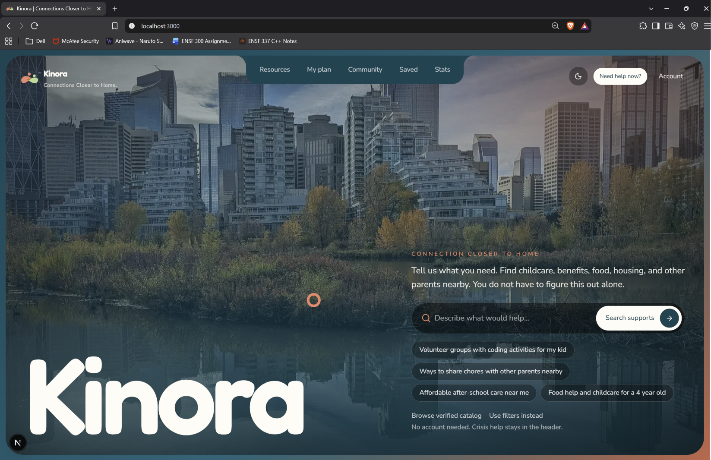

# Kinora

**Kinora is a web app for single parents in Calgary.** A parent describes their situation in their own words. Kinora then matches them to sourced, dated local supports for childcare, money, food and housing, and turns those matches into a short step-by-step plan, with crisis help one tap away on every page.

Built at Hack the Change 2026.



---

## The problem

Alberta had an estimated **206,891 one-parent families** on July 1, 2025 ([Statistics Canada, Table 17-10-0061-01](https://www150.statcan.gc.ca/t1/tbl1/en/tv.action?pid=1710006101)). In the 2021 Census, **77.2%** of one-parent families in Canada were led by women, and about **2.6 million children** (25% of children in census families) lived in a one-parent family ([Statistics Canada, StatsCAN Plus: The diversity of families in Canada](https://www.statcan.gc.ca/o1/en/plus/7574-diversity-families-canada)).

A single parent who needs childcare, money, food or housing help usually has to search many sites, check eligibility one by one, and do it with little time. Kinora asks them to describe their situation in their own words. It then matches them to sourced, dated local resources and turns those matches into a short plan with a clear first step for each one. Crisis help is always one tap away.

## Features

- **Describe your situation** (`/start`): a free-text box plus optional filters for postal code, distance, category, child's age and cost. The home hero has the same short form.
- **Personalized, ranked matches** (`/plan`): results ranked by category, distance, cost, child age and urgency, shown as a list and on a Mapbox map.
- **Support plan**: up to four actions, each with a reason and a first step ("Call … to ask about intake"). Signed-in parents can save the plan.
- **Crisis help**: a crisis button in the header on every page opens emergency and helpline contacts. If the parent's text contains crisis words, a crisis callout appears at the top of their plan, above the results.
- **Resources** (`/resources`): a browsable catalog with a map, a detail page for each resource, and a form to report outdated information.
- **Community** (`/community`): parents can ask questions, reply, vote posts helpful and report content. New posts are held for review in an admin moderation queue (`/admin/moderation`), and posts with emails, phone numbers or street addresses are blocked.
- **Saved items** (`/saved`): saved resources and a simple task checklist for signed-in parents. Browsing works without an account.
- **Account** (`/account`): sign in with Auth0, set preferences (such as children's age bands), and see your posts.
- **Stats** (`/stats`): Statistics Canada figures on one-parent families in Canada, Alberta and Calgary, with charts and linked sources.
- **Places carousel**: the home page's swipeable cards for childcare, money and benefits, food, housing, and other parents.
- **Pastel theme**: light by default, with a dark-mode toggle that remembers your choice.

## How personalization works

The full pipeline lives in [`lib/personalization/`](lib/personalization) ([`support-plan.ts`](lib/personalization/support-plan.ts)):

```
parent's text
   │
   ▼
1. Crisis check      keyword match, before any AI call
   ▼
2. User context      onboarding answers, or saved preferences if signed in
   ▼
3. Gemini intent     PII-redacted text → structured needs (Zod-validated JSON)
   ▼
4. Ranked retrieval  one SQL query on Supabase + PostGIS, then scoring
   │                 (category .4, distance .25, cost .2, age .15)
   │                 relaxes radius → budget → category if < 3 results; never age
   ▼
5. Gemini plan       3–6 steps grounded in the retrieved records only
```

Guarantees, enforced in code:

- **Gemini never invents resources or contact info.** The plan can only cite IDs from the retrieved set. Unknown IDs are dropped, and phone numbers, emails and URLs are stripped from Gemini's text. Contact details always come from the database.
- **Only the top retrieved records are sent.** Retrieval returns at most 10 records, and Gemini sees them without contact info, addresses or locations.
- **Everything works without AI.** Short messages (under 3 words) skip Gemini. If Gemini is off, times out or returns invalid JSON, a keyword fallback builds the intent, and ranked results are still returned without a plan.

> **Status:** this pipeline is fully tested (see `tests/`) but not yet connected to a route in this app. The live `/plan` page uses a lighter version of the same idea through `POST /api/search` ([`lib/search/`](lib/search), [`lib/matching/`](lib/matching)):
> - a keyword crisis check;
> - optional Gemini criteria extraction on sanitized text, only when `AI_ENABLED=true`, with a keyword fallback;
> - ranking;
> - a template-based plan.

## Privacy & safety

- **No personal identifiers go to Gemini.** Emails, phone numbers, postal codes, street addresses and self-introduced names are redacted first. Gemini never receives names, addresses, coordinates or Auth0 IDs; for children, it gets ages only.
- **The parent's text never goes in a URL and is never stored or logged.**
  - On the way to `/plan` it travels through `sessionStorage`, and the search is a `POST`.
  - A saved plan keeps only structured criteria and a summary.
- **"May be eligible" wording.** Kinora never tells a parent they *are* eligible.
  - The live plan says "Potentially eligible. Confirm with the provider."
  - The personalization pipeline labels reduced-cost options "may be eligible for reduced cost".
  - Gemini's plan text is rewritten from "eligible" to "may be eligible".
- **Crisis resources come first.** The crisis check runs before any AI call. Crisis contacts are static, never generated or changed by AI.
- **Community posts are opinions, not verified information.** They are held for moderation and blocked if they contain contact details.

## Tech stack

| Area | Tools |
|------|-------|
| Framework | Next.js 16 (App Router, Turbopack), React 19, TypeScript |
| Styling | Tailwind CSS v4, Radix UI primitives, `class-variance-authority`, `lucide-react`, `framer-motion` |
| Data | Supabase Postgres + PostGIS, Drizzle ORM, `postgres` / `pg` |
| Auth | Auth0 (`@auth0/nextjs-auth0` v4) |
| AI | Google Gemini (`@google/genai`), Zod schemas |
| Maps | Mapbox GL |
| Testing | Vitest, PGlite |
| Tooling | pnpm, ESLint, `tsx`, `drizzle-kit` |

## Getting started

### Prerequisites

- **Node.js** 20.12 or newer (the seed script uses `process.loadEnvFile`).
- **pnpm 11.14.0** (pinned in `packageManager`). If pnpm isn't installed, for example on Windows, prefix each command with `npx pnpm@11.14.0` instead of `pnpm`.

### Install

```bash
pnpm install
```

### Environment

```bash
cp .env.example .env.local
```

Fill in `.env.local`, and never commit it. The app builds and runs with only some of these set; features that need a missing service fall back or show a notice.

| Group | Variables |
|-------|-----------|
| Database | `DATABASE_URL`, `DIRECT_URL` |
| Supabase (optional) | `NEXT_PUBLIC_SUPABASE_URL`, `NEXT_PUBLIC_SUPABASE_PUBLISHABLE_KEY`, `SUPABASE_SECRET_KEY` |
| Auth0 | `AUTH0_SECRET`, `AUTH0_DOMAIN`, `AUTH0_CLIENT_ID`, `AUTH0_CLIENT_SECRET`, `APP_BASE_URL`, `ADMIN_AUTH0_SUBS` |
| AI | `GEMINI_API_KEY`, `GEMINI_MODEL`, `AI_ENABLED` |
| Maps | `MAPBOX_TOKEN`, `NEXT_PUBLIC_MAPBOX_TOKEN` |

Without `DATABASE_URL`, the catalog falls back to `data/resources.csv`. AI stays off until `AI_ENABLED=true`.

### Seed the database

```bash
pnpm db:seed:personalization
```

This upserts the sample organizations from `data/organizations.json` into `resources`. `pnpm db:seed` upserts the placeholder rows in `data/resources.csv`, and `pnpm db:verify` checks PostGIS, row-level security (RLS) and the resource count.

> The team's Supabase schema is managed by its owner. Don't run `pnpm db:migrate`, `pnpm db:generate` or `drizzle-kit push` against the shared database.

### Run

```bash
pnpm dev
```

Then open http://localhost:3000.

### Test

```bash
pnpm test
```

```bash
pnpm lint
```

```bash
pnpm typecheck
```

## Project structure

```
app/
  (marketing)/     landing page (hero, places carousel)
  (main)/          start, plan, resources, community, saved, account, stats, admin
  api/             search and geocode route handlers
  actions/         server actions (plans, saved items, tasks, community, feedback)
components/        UI grouped by feature, plus shadcn-style ui/
lib/
  personalization/ crisis → context → Gemini intent → PostGIS retrieval → Gemini plan
  search/, matching/  the live /plan search, ranking and template plan
  ai/              Gemini client, prompts, schemas, PII sanitizer
  safety/          crisis keywords and static crisis contacts
  db/              Drizzle schema and queries
  ...              auth, env, mapbox, moderation, resources, stats, theme
scripts/           migrate, seed, verify and persona scripts
data/              sample resources, organizations and families
drizzle/           SQL migrations and the read-only pull config
docs/              PRD.md, DECISIONS.md, SCHEMA.md
tests/             Vitest suites
```

## Data

**All resource data in this repo is fake sample data for the demo.**

- The organizations and families in `data/organizations.*` and `data/families.*` are synthetic personas with fictional names and neighbourhoods.
- The rows in `data/resources.csv` are marked `PLACEHOLDER` and use `example.invalid` links.

A real deployment would need verified Calgary records:
- each one checked against an official source, geocoded, and dated with `last_verified_at`;
- crisis phone numbers confirmed by the team before launch.

See [`docs/DECISIONS.md`](docs/DECISIONS.md).

Statistics on the `/stats` page come from Statistics Canada, with sources linked on the page. The Calgary figures still need their exact table and year confirmed.

## Data & verification

Priority is A; B is optional.

| Item | What it means | Status |
|------|---------------|--------|
| **A. Curated real Calgary resources** | About 40–60 real records, each with an official source link, geocoded, replacing all placeholder and synthetic rows. | Planned. The repo has only placeholder and synthetic data (see [Data](#data)). |
| **A. In-app verification workflow** | Each resource shows its source link and last-checked date. Old records get an "outdated" badge, and users can report wrong info for admins to review. No scraping of reviews. | Partly done. See the breakdown below. |
| **B. Google Places ratings (optional)** | Ratings or review snippets from the official Google Places API. Needs an API key and Google attribution; no scraping. | Planned. Not in the code. |

What exists for the verification workflow today:

- **Source link and last-checked date:** shown on each resource's detail page, from `source_url` and `last_verified_at`. Both are required in the database schema.
- **"May be outdated" badge:** shown on resource cards and detail pages when a record was last checked more than 180 days ago. The age is measured from a fixed reference date (2026-11-07), not today's date.
- **Report form:** anyone can report a resource as "May be outdated", "Wrong details", "Seems closed" or "Other", with an optional note. They are saved to `resource_feedback` with status `open`.
- **Not built yet:** an admin screen to review and resolve those reports.

## Team

Tanek Friesen, Parin Patel, Godwin Mercado, Elyanna Bouma, Vyapak Bansal

## License

[MIT](LICENSE)
