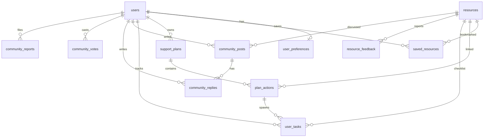

# Database schema

Personalized Support Navigator stores all app data in **Supabase Postgres** with **PostGIS**. The server connects through Drizzle ORM using a pooler URL (`prepare: false`). This document matches `lib/db/schema.ts` and `drizzle/0000_init.sql`.

## ER overview



## Design principles

- **Verified catalog only in `resources`.** No AI-generated rows. Community text never joins matching queries.
- **Approximate user location only.** `user_preferences.approx_location` is a rounded point (see below). No user street addresses.
- **RLS on every table, no policies.** Blocks Supabase auto-API access if a key leaks. The app role bypasses RLS; authorization lives in server code (`requireUser()`, ownership checks).
- **Text enums as `text` + `CHECK`.** Keeps migrations simple and matches Drizzle schema checks.

## Tables

### `users`

Auth0 identity and community profile.

| Column | Type | Notes |
|--------|------|--------|
| id | uuid PK | `gen_random_uuid()` |
| auth0_sub | text UNIQUE NOT NULL | Auth0 subject |
| email | text | Account only, never shown in UI |
| display_name | text UNIQUE | Pseudonym for community; 3 to 24 chars enforced in app |
| role | text | `user` or `admin` (CHECK); admin from `ADMIN_AUTH0_SUBS` at login |
| rules_accepted_at | timestamptz | First community post |
| created_at | timestamptz | |

### `user_preferences`

Optional onboarding snapshot for logged-in users.

| Column | Type | Notes |
|--------|------|--------|
| user_id | uuid PK FK users | CASCADE delete |
| postal_fsa | text | First 3 chars only (e.g. `T2Y`); CHECK length 3 |
| approx_location | geography(Point,4326) | Rounded geocode, nullable |
| child_age_bands | text[] | `ages_0_3`, `ages_3_8`, `ages_8_12`, `ages_12_17`, `ages_18_plus` |
| interest_tags | text[] | Search seeding tags (childcare, activities, parent_connection, …) |
| child_first_names | text[] | Optional private first names; never sent to Gemini |
| open_to_meet_parents | boolean | Preference for community connection nudge |
| categories | text[] | Resource category slugs |
| budget_band | text | App-defined bands |
| language | text | Default `en` |
| updated_at | timestamptz | |

### `resources`

Verified Calgary catalog.

| Column | Type | Notes |
|--------|------|--------|
| id | uuid PK | |
| slug | text UNIQUE NOT NULL | Seed upsert key |
| name, description | text NOT NULL | |
| category | text NOT NULL | CHECK: 8 PRD categories |
| subcategory | text | |
| address_line, city, postal_code | text | Public provider address |
| location | geography NOT NULL | GiST index; lon/lat order in SQL |
| cost_type | text NOT NULL | `free`, `subsidized`, `income_based`, `paid` |
| cost_notes | text | |
| age_min_months, age_max_months | int | CHECK min <= max |
| eligibility_summary | text | |
| eligibility_requirements | text[] | |
| languages | text[] | Default `{en}` |
| phone, email, website | text | |
| source_url | text NOT NULL | |
| last_verified_at | timestamptz NOT NULL | 180-day outdated badge in UI |
| verified_by | text | |
| is_active | boolean | Default true |
| search_tsv | tsvector GENERATED | English FTS on name, description, eligibility_summary; GIN |
| created_at, updated_at | timestamptz | |

### `saved_resources`

| Column | Type | Notes |
|--------|------|--------|
| user_id, resource_id | uuid PK | Both CASCADE with parent |
| created_at | timestamptz | Index `(user_id, created_at)` |

### `support_plans`

Persisted My Support Plan for a logged-in user.

| Column | Type | Notes |
|--------|------|--------|
| id | uuid PK | |
| user_id | uuid NOT NULL FK | CASCADE |
| criteria | jsonb | Structured search criteria (Zod in `lib/ai/schemas.ts`; see `SupportPlanCriteria` type) |
| created_at | timestamptz | Index `(user_id, created_at DESC)` |

### `plan_actions`

Three to four ranked actions per plan.

| Column | Type | Notes |
|--------|------|--------|
| id | uuid PK | |
| plan_id | uuid FK support_plans | CASCADE |
| resource_id | uuid FK resources | SET NULL on resource delete |
| title, reason, first_step | text NOT NULL | |
| priority | int NOT NULL | Lower or higher per app convention; CHECK >= 0 |
| status | text | `todo` or `done` |
| completed_at | timestamptz | |

### `user_tasks`

Application checklist (should-have FR-10).

| Column | Type | Notes |
|--------|------|--------|
| id | uuid PK | |
| user_id | uuid FK | CASCADE |
| resource_id | uuid FK | SET NULL |
| plan_action_id | uuid FK | SET NULL |
| title | text NOT NULL | |
| status | text | `todo` or `done` |
| due_date, created_at, completed_at | timestamptz | |

### `resource_feedback`

User reports on catalog quality (FR-11).

| Column | Type | Notes |
|--------|------|--------|
| id | uuid PK | |
| resource_id | uuid FK | CASCADE |
| user_id | uuid FK | SET NULL (optional reporter) |
| type | text | `outdated`, `wrong_info`, `closed`, `other` |
| note | text | Max 500 chars (CHECK) |
| status | text | `open`, `resolved`, `dismissed` |
| created_at | timestamptz | |

### `community_posts`

| Column | Type | Notes |
|--------|------|--------|
| id | uuid PK | |
| author_id | uuid FK users | CASCADE |
| category | text | Board categories (includes `other`; CHECK) |
| resource_id | uuid FK | Optional link; SET NULL |
| title | text | Max 120 (CHECK) |
| body | text | Max 2000 (CHECK) |
| status | text | `pending`, `published`, `flagged`, `removed` |
| moderation | jsonb | AI pass output (`CommunityModerationMeta`) |
| helpful_count | int | Denormalized; CHECK >= 0 |
| search_tsv | tsvector GENERATED | title + body; GIN |
| created_at, updated_at | timestamptz | |

### `community_replies`

Flat reply level only (no nesting).

| Column | Type | Notes |
|--------|------|--------|
| id | uuid PK | |
| post_id | uuid FK | CASCADE |
| author_id | uuid FK | CASCADE |
| body | text | Max 1000 (CHECK) |
| status, moderation, helpful_count | | Same pattern as posts |
| created_at | timestamptz | |

### `community_votes`

One helpful vote per user per post or reply.

| Column | Type | Notes |
|--------|------|--------|
| user_id, target_type, target_id | PK | `target_type` is `post` or `reply` |
| created_at | timestamptz | |

### `community_reports`

| Column | Type | Notes |
|--------|------|--------|
| id | uuid PK | |
| reporter_id | uuid FK | CASCADE |
| target_type, target_id | | Post or reply |
| reason | text | CHECK aligned with FR-21 |
| note | text | |
| status | text | `open`, `actioned`, `dismissed` |
| resolved_by | uuid FK users | Admin; SET NULL |
| resolved_at | timestamptz | Admin action time |
| created_at | timestamptz | |

## Index strategy

| Index | Purpose |
|-------|---------|
| GIST `resources.location` | PostGIS radius and distance |
| GIN `resources.search_tsv` | Catalog keyword search |
| btree `resources (is_active, category)` | Filtered browse |
| GIN `community_posts.search_tsv` | Board keyword search |
| btree `community_posts (status, category, created_at DESC)` | Published lists by category |
| btree `community_posts (author_id, created_at)` | Rate limit: 5 posts/day |
| btree `community_replies (author_id, created_at)` | Rate limit: 20 replies/day |
| btree `community_reports (reporter_id, created_at)` | Rate limit: 10 reports/day |
| btree `community_reports (target_type, target_id, status)` | Open report counts (auto-flag at 3) |
| btree `community_replies (post_id, status)` | Thread loading |

Rate limits use server-side `COUNT(*)` with time windows; no Redis.

## RLS

Every table: `ENABLE ROW LEVEL SECURITY` with **no permissive policies**. Intended for defense in depth, not app authorization.

## Approximate location rule (PRD §8.2)

1. Geocode postal code or neighbourhood with Mapbox on the server.
2. Round latitude and longitude to **2 decimal places** (~1 km).
3. Store in `user_preferences.approx_location` as `geography(Point,4326)`.
4. Never store user street addresses or use browser geolocation in MVP.

Resource `location` uses full provider coordinates for map pins and distance.

## JSONB shapes

- **`support_plans.criteria`**: Gemini or filter-derived criteria. Validated in application code before insert. Type: `SupportPlanCriteria` in `lib/db/schema-constants.ts`.
- **`moderation` on posts/replies`**: Flags from the Gemini moderation pass plus optional metadata. Type: `CommunityModerationMeta`.

## Seed notes

- `scripts/seed.ts` reads `data/resources.csv` and upserts by `slug`.
- Inserts omit `search_tsv` (generated column).
- Location: `ST_SetSRID(ST_MakePoint(longitude, latitude), 4326)::geography` (longitude first).
- Placeholder rows must be replaced with source-checked data before launch.

## TypeScript exports

- Table schemas and `$inferSelect` / `$inferInsert` types: `lib/db/schema.ts`
- Shared enum literals and JSON types: `lib/db/schema-constants.ts`
- Custom types: `lib/db/geo-type.ts`, `lib/db/tsvector-type.ts`

## Applying migrations

Fresh database:

```bash
pnpm db:migrate
pnpm db:seed
```

Requires `DIRECT_URL` (or migrate script equivalent) in env. Do not commit `.env` files.

If a database already ran an older `0000_init.sql`, drop and recreate, or add a forward migration for new columns and indexes before seeding.
